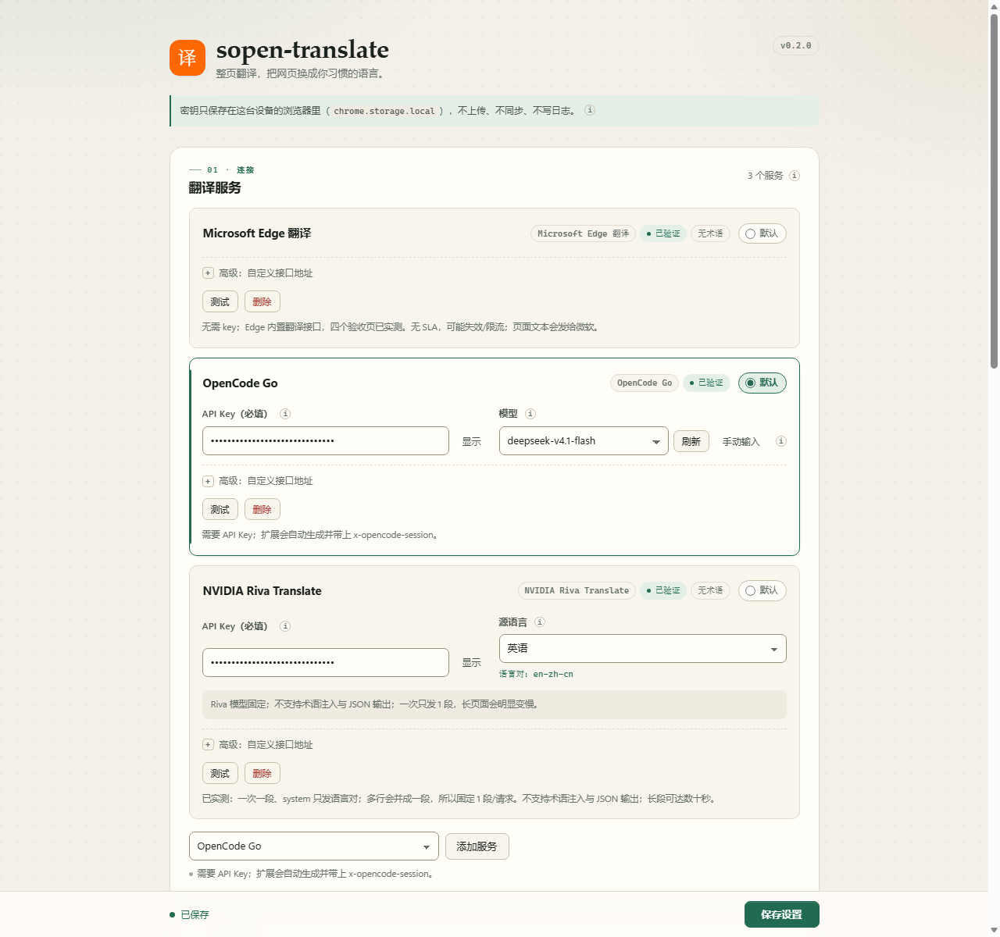
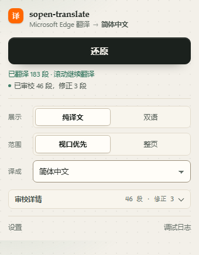
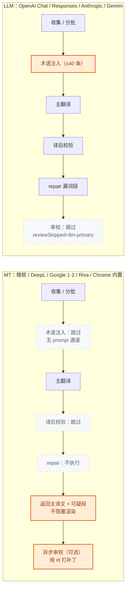
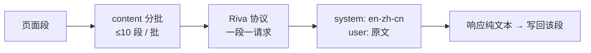

# sopen-translate

轻量网页整页翻译扩展：**先翻当前视口，滚动继续补翻**；翻译服务与 API 密钥由你自己配置，密钥只留在本机浏览器。

- **视口优先**：首屏先出译文，滚动、窗口变化、SPA 新内容自动补翻；也能切「整页」一次翻完
- **术语保护**：品牌 / 型号 / 协议名保持原文，内置词库 + 自定义词表 + 三档漏词策略
- **纯译文 / 双语**：随时还原，双语只往块内末尾追加 `span`，不破坏表格与列表
- **20 个内置服务预设**：LLM、DeepL、微软、Google 1 / Google 2、NVIDIA Riva、Chrome 端侧翻译，全部可自定义
- **可选异步审校**：主译文先渲染，规则筛出的可疑段随后交给第二个 LLM 修正，可查看 diff、可撤销
- **无后端、无打包、无运行时依赖**：`extension/` 目录就是可加载产物



<p align="center">
  
</p>

## 快速开始

1. 打开 `chrome://extensions`（Edge 用 `edge://extensions`），开启「开发者模式」
2. 「加载已解压的扩展程序」，选择仓库里的 `extension/` 目录
3. 首次安装会自动打开设置页：
   - 选一个预设（没有 key 可先用 **Microsoft Edge 翻译** 或 **Chrome 内置翻译**；后者首次要点「准备语言包」）
   - 填 API Key → 点「刷新」拉模型 → 点「测试」确认连通 → 保存
4. 点工具栏图标 → 「翻译」；再点「还原」回到原文

> 设置页每个容易困惑的字段旁边都有 **ⓘ 信息提示**：鼠标悬停、键盘聚焦或点击即可查看解释，按 `Esc` 或点击别处关闭。

## 功能

### 视口优先与整页

- **视口优先（默认）**：只翻当前视口 + 上下 500px 余量，首屏先出译文；滚动 / 尺寸变化 / SPA 新插入内容时继续补翻，标签页隐藏时暂停。
- **整页**：一次翻完当前页面，适合需要全文对照的场景。
- 视口首屏与续翻会把批次再切小（≤2000 字符 / 60 段），让第一批尽快出现；整页仍按服务策略分批。
- 进度只统计已送翻的段，滚动发现新内容时总数会增长，不要当成整页百分比。

### 纯译文与双语

- 纯译文直接替换文本节点；双语把译文追加到块元素内部末尾（`span` + `display:block`），不新增兄弟 `div`。
- 只按 `p / li / h1-h6 / td / th / ...` 收集块；纯 `div` 页面会把「没有块级后代且文本 ≥40 字」的 `div / section / article / main` 当块。
- 超过 1200 字符的块按句切开送翻，再拼回一个译文块。
- 含代码的块（`pre / code / kbd / samp / ...`）整块跳过，避免把代码翻坏。
- 切换模式或范围后，已翻译的页面需要先「还原」再重新翻译。

### 术语保护

目标是让 `DeepSeek V4.1 Flash` 不被译成「深度求索 4.1 闪电版」。

- **内置词库**：797 条，来自人工 allowlist + 上游筛选快照（simple-icons CC0、models.dev MIT），构建时离线生成，运行时不联网。
- **自定义词表**：一行一个词，只做「保持原文」。
- **型号规则**：`GPT-5`、`V4.1`、`M3.1` 这类“字母 + 版本号”自动保护；`V4` / `M3` 这类短型号靠词表里的全名。
- **三档漏词策略**：
  - `fallback`：漏词就整段保留原文，最保守；
  - `repair`：只重翻漏词段，仍漏才保留原文（默认）；
  - `warn`：译文照常显示，只提示可能漏词。
- 每批最多把 40 条命中术语注入 prompt，校验也只针对这 40 条。
- **DeepL、微软翻译、Google 1 / Google 2、NVIDIA Riva、Chrome 内置翻译没有 prompt 通道**：扩展对它们完全跳过术语层，不注入、不校验、不回退。

### 审校（可选，默认关闭）

审校是给 MT 兜底的一层规则 + LLM 修正，**不阻塞首屏**：

1. 主翻译返回后立即渲染，同时把规则筛出的可疑段随响应带回；
2. content 用 300–500ms 防抖把多批候选合并，主动发 `review.run`；
3. 主译文已经在页面上，审校结果回来后才按稳定 segment id 打补丁；
4. 页面还原 / 重新翻译会让晚到的审校响应失效（generation 校验），不会污染已还原的页面。

规则先筛：术语缺失、空译 / 与原文相同、长度比异常、目标脚本不对、数字 / URL / 占位符变化、相邻段完全重复。预算按页面累计 **200 段 / 8,000 字符**，超出标记 `truncated`；失败最多退避重试一次。

**只对 MT 主翻译生效**：LLM 主翻译已经走术语注入 + `repair`，不再重复审校。修正要通过二次校验才会写回 DOM：目标脚本、长度比、数字 / URL / 占位符、HTML 标签数量、术语保留；不通过的条目保留主译文并记入报告。

弹窗里可以展开「审校详情」，逐条看 `原文 → 主译文 → 修正`、原因标签与拒绝原因，并「撤销本次审校」。

### 模型列表

- 模型下拉 + 「刷新」：调用后台 `models.list`，只有真正联网拿到的列表才写缓存；
- 刷新失败 / 超时 / 接口没有列表时静默退回预设建议，不弹红字；
- 也可以切「手动输入」，直接填模型 id。

### 调试日志（默认关闭）

真机排障用：开启后记录翻译开始 / 结束、批次失败与重试、滚动补扫、审校、还原、错误与手动备注，只写 `chrome.storage.local`。

- 环形缓冲最多 **500 条 / 约 1MB**，单条超 8KB 截断；
- 默认**不记录页面正文**；只有显式开启「记录翻译样本」才记录每段最多 120 字，并在导出文件里标记 `samples: true`；
- 导出为 `sopen-debug-YYYYMMDD-HHmmss.json`，含版本、UA、脱敏后的设置摘要与日志；可复制或清空；
- 导出前统一脱敏：`Authorization` / `Bearer`、`apiKey`、`api_key`、`token`、`Ocp-Apim-Subscription-Key/Region`、`DeepL-Auth-Key`、`x-opencode-session`，以及 URL query 里的 `key=`；
- 入口：设置页底部「调试」卡片，或弹窗底部「调试日志」链接。

## 翻译服务与协议

内置 **20 个预设**，另可添加「自定义」（11 种协议任选）。设置页会标注「已验证 / 接口未实测」。

| 预设 | 协议 | 验证状态 |
| --- | --- | --- |
| OpenCode Go | OpenAI Chat | 已实测（自动带 `x-opencode-session`） |
| 商汤 SenseNova | OpenAI Chat | 已实测（RPM 较低，自动退避） |
| DeepL | DeepL | 已实测（不支持术语保护） |
| Microsoft Edge 翻译 | Microsoft Edge | 已实测（无需 key；内部接口无 SLA） |
| Chrome 内置翻译（端侧） | chrome-builtin | 接口未实测（需真机下载语言包；桌面版 Chrome/Chromium） |
| NVIDIA NIM · MiniMax M3.1 Flash | OpenAI Chat | 已实测（`{segments}` + `reasoning_effort=none`） |
| NVIDIA Riva Translate | nvidia-riva | 已实测（语言对 system；1 段/请求） |
| Google 1（网页接口） | google-free | 接口未实测（无需 key；单条请求，本机出口常 429） |
| Google 2（translate-pa） | google-pa | 已实测（批量 POST；需要 `X-Goog-API-Key`，可点按钮临时填入公共 key） |
| Microsoft Azure Translator | Microsoft Azure | 接口未实测（需要 key + Region） |
| Index-Translate（本地代理） | OpenAI Chat | 接口未实测（需要本地代理） |
| OpenAI / DeepSeek / Kimi / 智谱 / 阿里百炼 / MiniMax / OpenRouter / 硅基流动 | OpenAI Chat | 接口未实测 |
| 自定义 | 11 种协议任选 | 取决于你填的地址 |

协议清单：`openai-chat`、`openai-responses`、`anthropic-messages`、`google-gemini`、`microsoft-edge`、`microsoft-azure`、`google-free`、`google-pa`、`deepl`、`nvidia-riva`、`chrome-builtin`。

### NVIDIA 两个预设

- **NVIDIA NIM · LLM**：`https://integrate.api.nvidia.com/v1`，当前只验证 `minimaxai/minimax-m3.1-flash`。走完整 prompt + 术语层，`GET /v1/models` 可用，`reasoning_effort: "none"` 与 `response_format: json_object` 实测可用。
- **NVIDIA Riva Translate**：模型 `nvidia/riva-translate-4b-instruct-v2`，专用翻译模型，**system message 必须是语言对**（如 `en-zh-cn`），不能塞术语或翻译指令。实测多行输入会被合并成一段，因此固定 **1 段/请求**；不发送 `response_format`，也不支持 JSON 输出。短段 1–8s、长段可达数十秒，超时上限 120s。
- Riva 的源语言在卡片里选；目标语言仍是全局设置。语言对由 `rivaPair()` 映射（`ZH-HANS → zh-cn`、`ZH-HANT → zh-tw`、`ES → es-ES`、`PT → pt-BR`）。
- 两者的 key 都只从设置页读取，只存在 `chrome.storage.local`。

### Chrome 内置翻译（端侧）

- 走 Chrome / Chromium 自带的 **Translator API**：模型在本机运行，页面文本不出设备，也不需要 key。
- 首次使用某个语言对时，先在服务卡片点「准备语言包」下载一次；之后直接翻译。语言对由 `builtinLang()` 映射（`ZH-HANS → zh`、`ZH-HANT → zh-Hant`）。
- Translator API 只在 window 上下文可用，所以扩展用 `offscreen.html` 承载；manifest 里的 `offscreen` 权限只服务这一项。
- 仅桌面版 Chrome/Chromium 支持；语言包没下载时会提示去设置页准备；不支持的语言对会直接报错。
- 它和 Chrome 浏览器里“翻译此页”用的云端服务不是同一条路径；想走 Google 的云翻译请用「Google 1」或「Google 2」。
- 端侧模型逐段处理，扩展按 2000 字符 / 20 段 / 单路分批，避免一次塞太多。

### Google 1 与 Google 2

这两个预设都接 Google 翻译，但用的是不同的网页接口，不要混为一谈：

| | Google 1（网页接口） | Google 2（translate-pa） |
| --- | --- | --- |
| 请求 | `GET https://translate.googleapis.com/translate_a/single?client=gtx&dj=1...` | `POST https://translate-pa.googleapis.com/v1/translateHtml` |
| 批量 | 一次一个 `q`，长文本要切开串行 | 一次可发多段 |
| 鉴权 | 不需要 key | 需要 `X-Goog-API-Key` |
| 请求体 | query 参数 | `[[texts, "auto", "zh-CN"], "wt_lib"]` |
| 响应 | `sentences[].trans` | `[[translations...], [langs...]]` |
| 稳定性 | 非官方，本机出口实测常返回 429 | 批量接口，实测更稳 |
| 适用 | 快速试一下、没有 key | 需要稳定批量翻译，且有 Google API key |

- 两个预设都跳过术语层（MT 没有 prompt 通道）。
- **Google 2 的 key**：可以点「使用公共测试 key」，扩展会从 KISS Translator 的公开源码临时读取并填入当前草稿（不写进仓库、可能随时失效）；也可以填你自己的 Google API key。
- Google 2 的协议名是 `google-pa`，预设页会显示请求地址与 `X-Goog-API-Key` 说明；Google 1 的协议名是 `google-free`。
- 两者都会把页面文本发给 Google；不需要联网的端侧方案是「Chrome 内置翻译」。

### 微软翻译

- **Edge**：浏览器内置翻译的内部免费接口，无需 key；可能限流或改路径。
- **Azure**：官方接口，需要 key；区域资源还要填 `Region`。
- 两者都会把页面文本发给微软，且都跳过术语层。

### Index-Translate

免费 LLM，但公网接口对浏览器 / 扩展返回 412，需要先在本地跑代理（默认 `http://127.0.0.1:8080/v1`）。

## 三条翻译路径

同一套 `translate` 管线，三条路径只在「术语注入 / repair / 审校」三处分叉。



- **LLM**：术语注入 → 译后校验 → `repair` 漏词段；不再重复审校，省一次请求与同池 429 风险。
- **MT**：术语层与 `repair` 全部跳过；异步审校是唯一的事后补救，只修规则看得见的硬伤。
- **共同点**：原序等长、连续 3 批失败熔断、失败批补跑、`pageToken` 审校预算、还原语义都不变。

### NVIDIA Riva 的单段路径



## 设置页与弹窗

- **配置流程**：选预设 → 填 key → 刷新模型 → 测试 → 保存。测试用草稿配置直接发请求，不要求先保存。
- 预设按「已验证 / 接口未实测 / 自定义」分组；卡片显示预设、验证状态、默认单选项。
- API Key 支持显示 / 隐藏；必填项缺失会在字段旁标出，保存时汇总并滚动到第一个问题。
- 底部保存栏提示未保存更改、保存中 / 成功 / 失败。
- 弹窗（320–360px）里主按钮始终优先显示「还原」；翻译中显示进度；审校中 / 已审校状态单独一行，详情可展开。

## 隐私与数据流向

- **密钥**：只存在本机 `chrome.storage.local`，只有 service worker 读取；content script 看不到，不上传、不写日志、不导出。Google 2 的「公共测试 key」只在点击时从 KISS 公开源码读取并填入草稿，不写进仓库或日志。
- **页面文本**：发给**你当前启用的主翻译服务**。具体厂商取决于预设：
  - LLM 预设：文本 + prompt 发给对应 API；
  - DeepL / Azure / NVIDIA：发给对应厂商；
  - Edge 翻译：发给微软的内部接口；
  - Google 1 / Google 2：发给 Google 的网页翻译接口（Google 2 需要你的 API key）；
  - Chrome 内置翻译：端侧模型在本机运行，页面文本不发出去。
- **审校**：配置后，可疑段还会发给所选的审校服务（多一个数据流向）；只送规则筛出的段，不送整页。
- **调试日志**：只写本机存储；不自动上传、不联网；导出文件已脱敏，默认不含页面正文。

## 常见问题

**401 / 403**
：key 错、过期、没权限，或该 key 不属于这个 baseUrl。先看设置页「测试」的错误里的 host。

**429 / 熔断**
：端点限流。扩展只对 429 做退避；连续 3 批失败会熔断并保留已翻部分。长页面优先用 DeepL / 微软 MT，或换低 RPM 的服务。

**没有模型列表**
：部分服务不提供 `/models`，刷新会静默退回预设建议；也可能 baseUrl 与预设不一致。可切「手动输入」。

**Edge 翻译失效**
：这是浏览器内部接口，无 SLA。改路径或限流时切 Azure / DeepL / 自定义。

**Riva 报错或很慢**
：确认 system 是语言对（设置页会显示预览），源语言与目标语言不能相同；Riva 是专用翻译模型，长段本来就可能数十秒。

**Chrome 内置翻译提示语言包未下载**
：到设置页该服务卡片点「准备语言包」，等下载完成再翻译；仅桌面版 Chrome/Chromium 支持，语言对不支持时会直接报错。

**Google 1 返回 429**
：非官方网页接口，出口 IP 被限流；换网络/代理，或改用 Google 2 / DeepL / 微软 / 自建服务。

**Google 2 提示缺少 X-Goog-API-Key**
：点服务卡片里的「使用公共测试 key」临时填入（来自 KISS Translator 公开源码，可能随时失效），或到 Google Cloud 控制台启用 Translation 相关 API 后填自己的 key。扩展不把第三方 key 写进仓库。

**审校没有反应**
：审校只对 MT 主翻译生效；LLM 主翻译会直接返回 `reviewSkipped = "llm-primary"`。另外没有可疑段时不会发请求。

**页面还原后又被改了一小段**
：正常版本不会发生——还原会清空队列并递增 generation，晚到的审校响应会被丢弃。若遇到，请开调试日志并导出给维护者。

**怎么排障**
：设置页启用「调试日志」→ 复现问题 → 写一条备注（例如“这里开始 429”）→ 导出 JSON。日志默认不含页面正文。

## 开发

```bash
npm install                        # 只装 typescript + @types/chrome
npm run check                      # tsc --noEmit，改完必须零错误
npm run smoke                      # provider / 协议 / 术语 / 审校 / NVIDIA / 调试日志（stub fetch）
npm run smoke:dom                  # content 状态机：渲染、还原、视口、并发、异步审校、撤销
npm run build:glossary             # 离线生成 extension/lib/glossary-data.json
npm run build:glossary -- --check  # 校验入库词库与源文件一致
```

分层、关键不变量、分批策略、加服务步骤和真机测试方法见 [CONTRIBUTING.md](CONTRIBUTING.md)。扩展没有打包步骤，`extension/` 就是产物。

## 状态

`0.2.0`。已实现：视口优先与整页、纯译文与双语、还原、术语三档、11 种协议、20 个预设、模型刷新、异步审校 + diff/撤销、NVIDIA Riva / MiniMax、Chrome 端侧内置翻译、Google 1 / Google 2、明暗主题与 ⓘ 信息提示、本地调试日志。

尚未实现：划词 / 右键翻译、翻译缓存、快捷键、按站点开关、用量统计、术语指定译法、审校全量评分、NVIDIA 其他模型、G2 Translator API。

已知限制：

- 只在顶层 frame 生效；不逐段保留页面内联标签结构。
- 双语模式跳过含代码的块；SPA 页面建议等渲染完成再点翻译。
- 长块按句切分会丢一点跨句上下文；单句超 1200 字符硬切。
- 无限滚动页面会持续产生补翻任务，靠熔断与隐藏暂停兜底。
- 20 个预设中只有 OpenCode Go / 商汤 / DeepL / Edge / NVIDIA 两个 / Google 2 做过真 key 端到端；Chrome 内置翻译完成了架构验证但未在真机下载语言包；其余为路由级或 stub 验证，baseUrl / 模型名可能过期。
- 审校只修规则看得见的硬伤，不承诺语义润色；配置后页面文本会多一个数据流向。

## 许可

本项目采用 [Apache License 2.0](LICENSE)，版权声明与第三方数据许可见 [NOTICE](NOTICE)。
